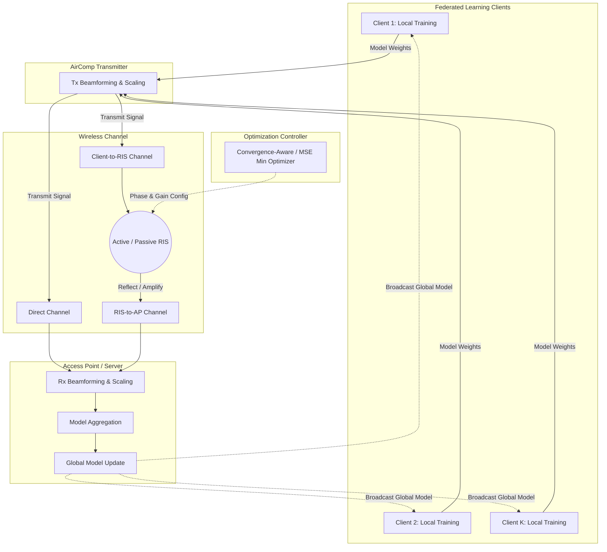

# AROTA-FL Comprehensive Documentation

This document provides a detailed overview of the **AROTA-FL** (Convergence-Aware Active RIS for AirComp-Based Federated Learning) project. It includes system architecture diagrams, step-by-step local and cloud setup instructions, and an in-depth explanation of the codebase structure.

---

## 1. Process Architecture & Workflow Diagram

The system integrates **Federated Learning (FL)** with **Over-the-Air Computation (AirComp)**, assisted by a **Reconfigurable Intelligent Surface (RIS)**. The process runs in a loop for multiple FL communication rounds.



### Workflow Steps:
1. **Local Training**: Devices (Clients) train the model locally using their respective data.
2. **Tx Scaling**: The clients normalize and scale their local model weights for simultaneous transmission.
3. **RIS Optimization**: The Optimization Controller configures the RIS phase shifts and amplification gains based on channel state information (CSI) to minimize expected aggregation error (Convergence-Aware).
4. **AirComp Transmission**: Signals are transmitted over the air. They pass through the direct channel and the RIS-reflected channel, interfering constructively at the Access Point (AP).
5. **Aggregation & Update**: The AP receives the superimposed signal, scales it back, aggregates the weights, and updates the global model. The new global model is broadcast back to clients for the next round.

---

## 2. Easy Setup Instructions (Without Errors)

### A. Local Setup (PC / Windows / Linux)

To run this locally without errors, it is highly recommended to use a Python virtual environment to avoid dependency conflicts.

**Step 1: Clone the Repository**
Open your terminal (Command Prompt, PowerShell, or Bash) and run:
```bash
git clone https://github.com/YOUR_USERNAME/AROTA-FL.git
cd AROTA-FL
```

**Step 2: Create a Virtual Environment**
Create a fresh Python environment:
```bash
# On Windows
python -m venv venv
venv\Scripts\activate

# On Linux / Mac
python3 -m venv venv
source venv/bin/activate
```

**Step 3: Install Dependencies**
Ensure your `pip` is up to date, then install the required libraries:
```bash
pip install --upgrade pip
pip install -r requirements.txt
```
*(Note: If you have a dedicated GPU and want to use PyTorch with CUDA locally, please visit [PyTorch's official site](https://pytorch.org/get-started/locally/) to install the correct CUDA-enabled PyTorch version before running the experiments).*

**Step 4: Run a Test Experiment**
To verify everything is working, run a lightweight wireless sweep:
```bash
python -m experiments.run_wireless_sweeps
```

---

### B. Google Colab Setup (Recommended for Heavy Experiments)

For intensive experiments like `CIFAR-10` FL simulations, Google Colab provides free GPUs that significantly speed up the process.

**Step 1:** Open the provided Colab Notebook by clicking this link or uploading the `Run_on_Colab.ipynb` file to your Google Drive and opening it with Colab.
**Step 2:** In the Colab menu, go to **Runtime > Change runtime type**.
**Step 3:** Set **Hardware accelerator** to **GPU** (e.g., T4 GPU) and click Save.
**Step 4:** Run the very first cell to clone the repository and install dependencies:
```python
!git clone https://github.com/YOUR_USERNAME/AROTA-FL.git
%cd AROTA-FL
!pip install -r requirements.txt
```
**Step 5:** Run any experiment block. For example:
```python
!python -m experiments.run_cifar10_exp10
```
**Step 6:** Download the generated figures via the final cell in the notebook.

---

## 3. Codebase Documentation

The repository is organized modularly in the `src/` folder. Below is the detailed explanation of each component.

### `src/channels/`
Handles the wireless environment modeling.
- **`channel_utils.py` / `rayleigh.py`**: Generates channel matrices. It includes distance-dependent path loss and Rician fading for Line-of-Sight (LoS) links (e.g., the RIS-to-AP link) and Rayleigh fading for Non-Line-of-Sight (NLoS) links.
- **`channel_estimation.py`**: Simulates imperfect Channel State Information (CSI) by injecting bounded or Gaussian error into the perfect channel matrices.

### `src/ris/`
Defines the Reconfigurable Intelligent Surface behavior.
- **`passive_ris.py`**: Models a traditional RIS that only shifts the phase of the incident signal without amplifying it.
- **`active_ris.py`**: Models an Active RIS that can both shift the phase and amplify the signal, but introduces thermal noise.
- **`phase_control.py` & `ris_power.py`**: Contains functions to compute the phase shifts and enforce hardware constraints, such as the maximum total power budget for the Active RIS.

### `src/aircomp/`
Handles the Over-the-Air Computation mechanics.
- **`beamforming.py`**: Computes the transmit and receive beamforming vectors (e.g., Zero-Forcing or Maximum Ratio Transmission) used by the clients and the AP.
- **`received_signal.py`**: Simulates the physical superposition of signals in the air, adding AWGN (Additive White Gaussian Noise) and RIS-induced noise.
- **`mse.py`**: Calculates the Mean Squared Error (MSE) between the ideal aggregated signal and the actual received signal. It contains both analytical formulas and empirical Monte Carlo validations.
- **`aggregation.py`**: The crucial bridge that maps the physical layer MSE into the Federated Learning weight update errors.

### `src/optimization/`
Contains the logic for configuring the RIS (Phase and Amplitude).
- **`baselines.py`**: Implements basic strategies like No-RIS, Passive-RIS, and a naive Fixed Active-RIS.
- **`mse_minimization.py`**: Implements a controller that purely tries to minimize the instantaneous signal MSE.
- **`convergence_aware.py`**: The core proposed algorithm. It optimizes the RIS expected MSE specifically tailored to bound the aggregation error, ensuring that the Federated Learning model mathematically converges faster and more reliably.

### `src/federated_learning/`
The FL simulation framework built with PyTorch.
- **`model.py`**: Neural network architectures for datasets like MNIST, Fashion-MNIST, and CIFAR-10.
- **`partition.py`**: Functions to divide datasets among clients in an Independent and Identically Distributed (IID) or Non-IID fashion (using Dirichlet distributions).
- **`client.py`**: Implements the local training loop (epochs, batch size, learning rate) for an individual client.
- **`server.py`**: Implements the global aggregation step, taking the noisy aggregated weights from the AirComp module to update the global model.

### `experiments/`
Contains executable scripts to run full simulations.
- **`run_wireless_sweeps.py`**: Tests physical layer metrics (MSE vs SNR, MSE vs Amplification).
- **`run_fl_sweeps.py` / `run_fl_extra_sweeps.py`**: Runs end-to-end Federated Learning simulations on simpler datasets (MNIST/Fashion-MNIST).
- **`run_cifar10_exp10.py`**: Runs the computationally heavy CIFAR-10 experiments, logging accuracy and loss over communication rounds.

---

## 4. How to Run and Reproduce Results

To generate the plots and results mentioned in the manuscript, execute the following commands from the root directory:

1. **Wireless MSE Comparison** (Validates Convergence-Aware vs MSE-Min):
   ```bash
   python -m experiments.run_wireless_sweeps
   ```
2. **Federated Learning on MNIST** (Varying CSI errors, Active vs Passive):
   ```bash
   python -m experiments.run_fl_sweeps
   ```
3. **Heavy CIFAR-10 FL Experiment**:
   ```bash
   python -m experiments.run_cifar10_exp10
   ```

All generated graphs and CSV logs will be saved automatically into the `results/figures/` and `results/data/` directories respectively.
